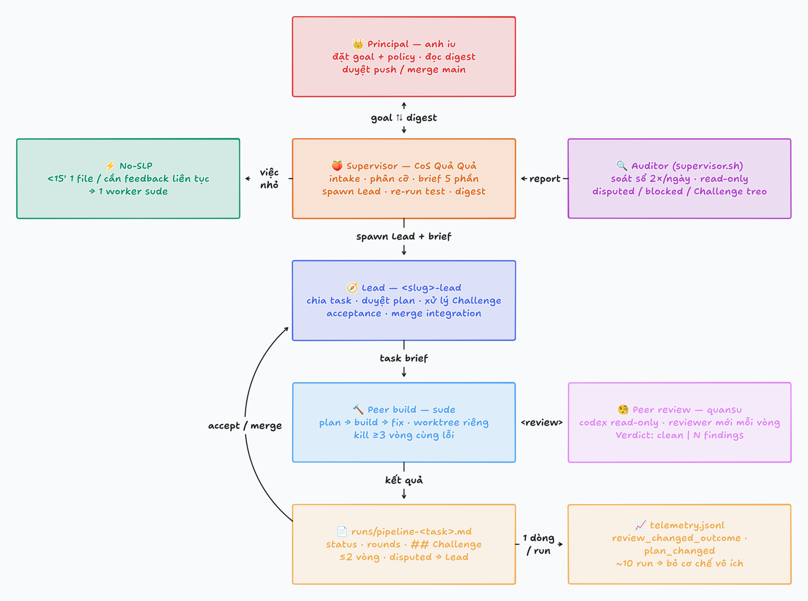

# Quaqua 🍑 — SLP orchestration on Herdr

A personal multi-agent setup following SLP (Supervisor – Lead – Peer) on [Herdr](https://herdr.dev).
The owner is the **Principal**, outside the system, and talks only to Quả Quả (Claude Code),
the **CoS** that fills SLP's Supervisor slot and owns the full SDLC; each project gets an
internal **Lead**; **Peers** are task workers in Herdr panes.
A read-only **Auditor** runs at 07:00 and 19:00 local time via systemd (Linux) or launchd
(macOS). Diagram: `docs/slp.png`.

This repo is the live workspace: clone it to `~/quaqua`. Per-workspace personal state
(`USER.md`, `MEMORY.md`, `memory/`, `projects/`, `raw/`, `runs/`, `reports/`) is gitignored and stays local; start
`USER.md` from `USER.example.md`.

## Architecture



```
 Principal (owner) — goal, priorities, trade-offs; approves push / merge to main
        │ goal                ▲ digest
        ▼                     │
 CoS (Quả Quả) — full SDLC: intake, sizing, brief, verify, release  ◄── report ── Auditor
        │ small task (<15 min, 1 file, or needs live feedback) ──► one worker, no SLP   (scripts/auditor/systemd/launchd
        │ spawn Lead + brief                                                           2×/day)
        ▼
 Lead (<slug>-lead) — project state, plan approval, acceptance,
        │ task brief                   merges into the project integration branch
        ▼
 Peers — build (sude) ⇄ review (suhuynh, claude read-only), own worktree each
        │ result                     default 2 review rounds (--rounds overrides); kill after ≥3 stuck
        ▼
 runs/pipeline-<task>.md ──► Lead accepts / merges      runs/telemetry.jsonl (1 line per run)
```

Rules:
- Brief has 5 sections: Goal / Hard constraints / Current design / Unknowns / Evidence; it never pre-solves.
- Peers may challenge premises in a `## Challenge` section; the Lead resolves it before acceptance.
- CoS never acts as Lead on pipeline-size work (no self-review); every redirect flows through CoS
  and is recorded in Lead state.
- Telemetry decides which mechanisms stay: a reviewer that rarely changes outcomes gets turned off.

## Files

| File | Role |
|---|---|
| `AGENTS.md` | Entrypoint: SLP roles, memory policy, worker protocol |
| `identity.md`, `SOUL.md` | CoS persona and voice |
| `PEER.md` | Worker contract: boundaries, contract-before-test, git commit gates, handback |
| `rules/_all/` | Worker rules injected as the system prompt (brief shape, fanout grid, timebox) |
| `models.md` | Worker roster: nickname → kind / model / effort |
| `.claude/settings.json` | Denies the built-in `Agent` tool so all workers go through Herdr |
| `.claude/skills/herdr-orchestration/` | Worker flow + consolidated command, recovery, and assignment/acceptance references |
| `scripts/auditor/auditor.sh` | Auditor: read-only drift + pipeline-run audit → `reports/audit-*.md` |
| `scripts/auditor/install-auditor.sh`, `scripts/auditor/systemd/`, `scripts/auditor/launchd/` | Auditor scheduling: systemd user units (Linux) or a rendered LaunchAgent plist (macOS), 2×/day |
| `quaqua init`, `templates/` | Bootstraps a fresh clone's gitignored personal state (dirs + `memory/rules.md`, `projects/INDEX.md`, `_template.md`, `USER.md`); idempotent, never overwrites |
| `tests/` | Sandboxed test suite: `tests/run.sh` runs every `tests/test_*.sh` (the 2 slow suites only when the change touches a script they cover, or with `--slow`) and exits non-zero on any failure |
| `USER.example.md` | Template for the per-workspace `USER.md` |
| `SETUP-PROMPT.md` | Original prompt used to bootstrap this setup |
| `docs/slp.png` | Diagram: Principal → CoS → Lead → Peers |

## New machine

A fresh clone has no personal state: `memory/`, `projects/`, `raw/`, `runs/`,
`reports/` and `USER.md` are gitignored and stay on the machine that created
them. Bootstrap the skeleton — the dirs plus `memory/rules.md`,
`projects/INDEX.md`, `projects/_template.md` and `USER.md` — with:

```bash
git clone git@github.com:therealtinhtute/quaqua.git ~/quaqua && cd ~/quaqua
quaqua init
```

`quaqua init` is idempotent and never overwrites an existing file, so it
is safe to re-run after a pull. Then edit `USER.md` for the workspace, add one
row per project to `projects/INDEX.md` (copy `projects/_template.md` for the
card), and continue with the auditor install below. Templates live in
`templates/` under depth-safe names because `.gitignore`'s `memory/` and
`projects/` patterns match at any depth.

## Install

```bash
git clone git@github.com:therealtinhtute/quaqua.git ~/quaqua && cd ~/quaqua
quaqua init     # dirs + rules.md, INDEX.md, _template.md, USER.md
bash scripts/auditor/install-auditor.sh  # installs scheduling files; prints manual activation command
```

Linux: the installer symlinks the user service/timer and calls only
`systemctl --user daemon-reload`. Activate manually with
`systemctl --user enable --now quaqua-auditor.timer`.

macOS: install a current Bash (e.g. `brew install bash`), then put its `bin` directory
first on PATH (`export PATH="$(brew --prefix bash)/bin:$PATH"` for Homebrew).
Run `bash scripts/auditor/install-auditor.sh` with `claude` on PATH. The installer requires
Bash >= 4.4 from `command -v bash` and refuses the macOS system Bash 3.2.
It renders `scripts/auditor/launchd/com.quaqua.auditor.plist.in` into
`~/Library/LaunchAgents/com.quaqua.auditor.plist`, pinning the discovered Bash,
this checkout's absolute `scripts/auditor/auditor.sh` path, and the install-time PATH (including
claude's directory). Logs go to `~/Library/Logs/quaqua-auditor.log`; reports still go
in this checkout's `reports/`. It never calls launchctl; run the printed bootstrap
command yourself. Reinstall after moving the checkout or changing toolchain paths.
Calendar intervals run at 07:00/19:00; unlike systemd's `Persistent=true`, launchd does
not replay missed runs while logged out (sleep wakeups may coalesce missed intervals).

Tests live in `tests/` and require Bash >= 4.4 (macOS system Bash 3.2 is insufficient),
git, jq, Perl, python3 (for plist validation), and ripgrep. They use temporary homes and
stub herdr/claude/managers; no network, real agents, or service activation is needed:

```bash
# On macOS, put your installed Bash's bin directory first on PATH as above.
tests/run.sh   # PASS/FAIL per test, then a count; exits non-zero on any failure
RUN_SLOW_TESTS=1 tests/run.sh   # also run the 2 slow suites (or: tests/run.sh --slow)
```

`tests/run.sh` skips the two slow suites (`test_prompt_worker.sh`, `test_pipeline.sh`)
unless the change touches a script they cover, and prints which it skipped and why.

Tests run locally only (no CI).

Run CoS (Quả Quả) from `~/quaqua` inside Herdr (`HERDR_ENV=1`); it spawns project Leads with
`quaqua lead spawn <slug>`.
